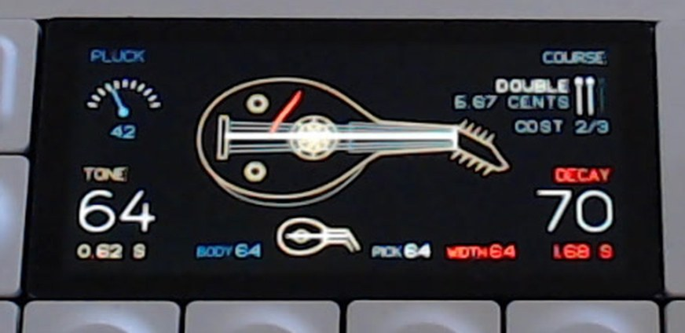
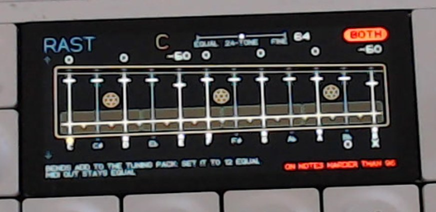
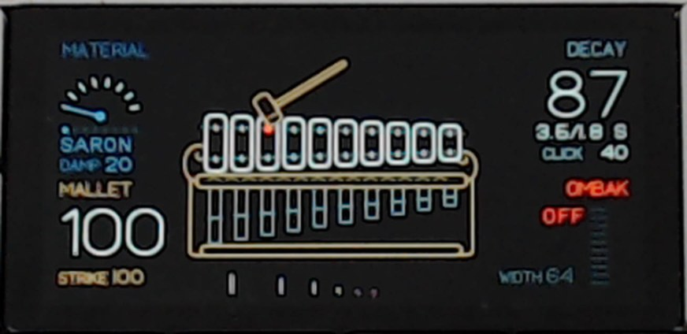
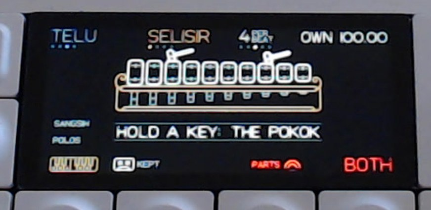
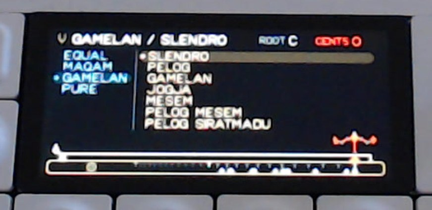
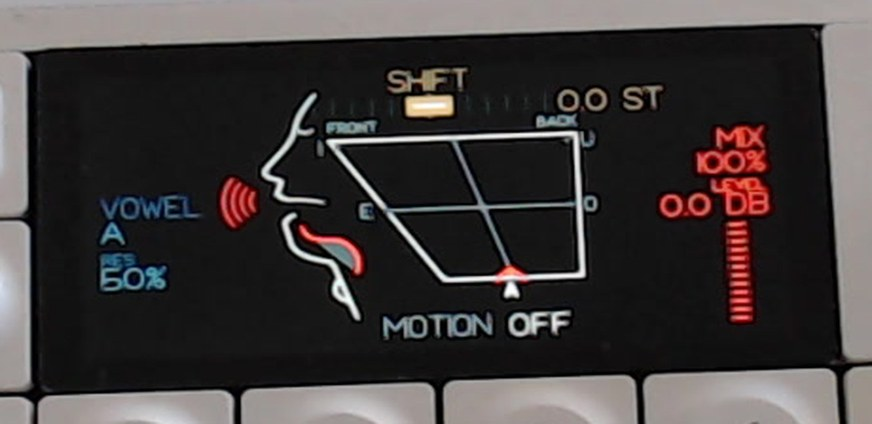
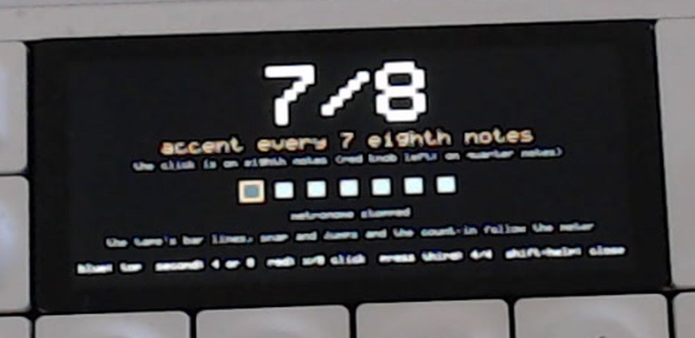
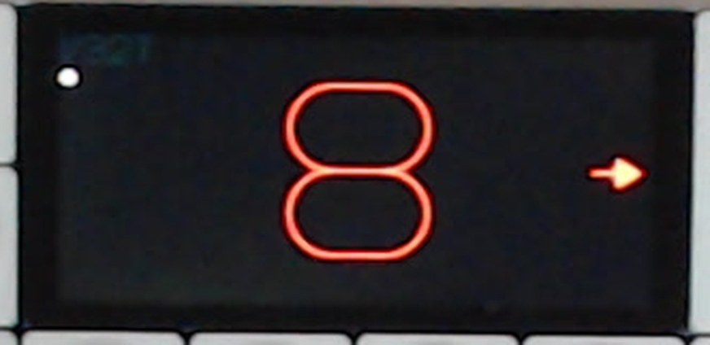

# open-field packs by hooligan333

Add-ons for the OP-1 Field on OS 1.7.3 with [open-field](https://github.com/LaP0573/open-field): synth engines, sequencers, a tuning tool, an effect, a meter pack and a small fix. Each pack is one file; its source, guide, screenshots and recordings are in its repository.

**[The same list as a page with audio players](https://hooligan333.github.io/open-field-packs/)**

| Pack | Version | Kind | What it does | Repository |
| --- | --- | --- | --- | --- |
| **oud** | 6 | synth engine | Plucked strings in courses: oud, saz, qanun, kora, harp, bouzouki and lute, with eight sounds and a drawn page. | [open-field-oud-maqam](https://github.com/hooligan333/open-field-oud-maqam) |
| **maqam** | 3 | sequencer | Tunes as you play: each key sounds a maqam's own pitch, quarter tones and all, with slides and trills. | [open-field-oud-maqam](https://github.com/hooligan333/open-field-oud-maqam) |
| **gangsa** | 6 | synth engine | Struck metal and wood: gamelan bars and gongs, mbira, bells and bowls, with ten sounds and a drawn page. | [open-field-gangsa-kotekan](https://github.com/hooligan333/open-field-gangsa-kotekan) |
| **kotekan** | 3 | sequencer | Hold one key and it weaves the two interlocking parts of Balinese kotekan around it, in four styles. | [open-field-gangsa-kotekan](https://github.com/hooligan333/open-field-gangsa-kotekan) |
| **tuning** | 8 | tool | Alternate tunings for the synth: maqam, gamelan, just and Pythagorean intonation, quarter tones, or your own from a Scala file. | [open-field-tuning](https://github.com/hooligan333/open-field-tuning) |
| **vowel** | 5 | effect | A vowel filter in the unit's list of effects: three formants that move between vowels, with a drawn page. | [open-field-vowel](https://github.com/hooligan333/open-field-vowel) |
| **meter** | 4 | tape and metronome | Meters other than 4/4: the metronome's accent, the count-in and the tape's bar lines, grid and jumps follow the meter. | [open-field-meter](https://github.com/hooligan333/open-field-meter) |
| **endless midi** | 6 | sequencer | Record endless's steps from a MIDI keyboard at the pitches played, over its whole range, while shift is held. | [open-field-endless-midi](https://github.com/hooligan333/open-field-endless-midi) |
| **pattern mode** | 1 | sequencer | The pattern sequencer keeps its play mode (backward, ping-pong or forward) over a restart. | [open-field-pattern-mode](https://github.com/hooligan333/open-field-pattern-mode) |

To put one on a unit: tick it on open-field's install page once it is listed there, or copy its `.pack` file into the unit's `packs` folder in disk mode and restart. Each repository's README says what was tried on a unit and what was not.

## oud

Plucked strings in courses: oud, saz, qanun, kora, harp, bouzouki and lute, with eight sounds and a drawn page. [Repository and guide](https://github.com/hooligan333/open-field-oud-maqam).

*Oud's page: a double course (a photo of the unit's screen).*

| Listen | What it is |
| --- | --- |
| [A taqsim in rast](docs/media/oud-01-taqsim-in-rast.mp3) | Solo oud in free time; the tuning pack on maqam / rast |
| [The eight sounds](docs/media/oud-02-the-eight-sounds.mp3) | One phrase on oud, oud dark, lute, kora, harp, bouzouki, saz and qanun |
| [Three parts in hijaz](docs/media/oud-03-three-parts-in-hijaz.mp3) | Oud dark, harp and bouzouki, played one at a time and layered |

## maqam

Tunes as you play: each key sounds a maqam's own pitch, quarter tones and all, with slides and trills. [Repository and guide](https://github.com/hooligan333/open-field-oud-maqam).

*Maqam's page: rast on C (a photo of the unit's screen).*

| Listen | What it is |
| --- | --- |
| [Rast with ornaments](docs/media/maqam-01-rast-ornament-off-slide-trill-both.mp3) | One phrase four times: ornament off, slide, trill, both |
| [Flavour](docs/media/maqam-02-rast-at-flavour-0-64-127.mp3) | The phrase at flavour 0 (equal), 64 (24-tone) and 127 (fine) |
| [Three maqamat](docs/media/maqam-03-rast-bayati-saba-on-c.mp3) | Rast, bayati and saba on C |

## gangsa

Struck metal and wood: gamelan bars and gongs, mbira, bells and bowls, with ten sounds and a drawn page. [Repository and guide](https://github.com/hooligan333/open-field-gangsa-kotekan).

*Gangsa's page: the sound saron (a photo of the unit's screen).*

| Listen | What it is |
| --- | --- |
| [The ten sounds](docs/media/gangsa-01-the-ten-sounds.mp3) | Gambang, mbira, saron, bonang, pair, gender, kempul, bell, bowl, gong |
| [Gamelan in slendro](docs/media/gangsa-02-gamelan-in-slendro.mp3) | Saron, bonang, gender, kempul and gong, layered; the tuning pack on gamelan / slendro |
| [Gong, bowl and bell in pelog](docs/media/gangsa-03-gong-bowl-bell-in-pelog.mp3) | Slow layers; the tuning pack on gamelan / pelog |

## kotekan

Hold one key and it weaves the two interlocking parts of Balinese kotekan around it, in four styles. [Repository and guide](https://github.com/hooligan333/open-field-gangsa-kotekan).

*Kotekan's page (a photo of the unit's screen).*

| Listen | What it is |
| --- | --- |
| [Four styles](docs/media/kotekan-01-four-styles.mp3) | One held line in nyog cag, norot, telu and empat |
| [A pokok line woven](docs/media/kotekan-02-a-pokok-line-woven.mp3) | A longer line with the pokok struck too: telu, then empat |
| [Five rates](docs/media/kotekan-03-five-rates.mp3) | The same line at 2, 3, 4, 6 and 8 steps a beat |

## tuning

Alternate tunings for the synth: maqam, gamelan, just and Pythagorean intonation, quarter tones, or your own from a Scala file. [Repository and guide](https://github.com/hooligan333/open-field-tuning).

*Tuning's page: gamelan / slendro (a photo of the unit's screen).*

| Listen | What it is |
| --- | --- |
| [One phrase in five tunings](docs/media/tuning-01-one-phrase-in-five-tunings.mp3) | 12 equal, maqam / rast, maqam / bayati, gamelan / slendro, gamelan / pelog |
| [Chords, equal then just](docs/media/tuning-02-chords-in-12-equal-then-just.mp3) | C, F, G, C held in 12 equal, then in pure / just |
| [Quarter tones](docs/media/tuning-03-the-keys-in-12-equal-then-24-equal.mp3) | The keys from C4 up in 12 equal, then in 24 equal, then a tune |

## vowel

A vowel filter in the unit's list of effects: three formants that move between vowels, with a drawn page. [Repository and guide](https://github.com/hooligan333/open-field-vowel).

*Vowel's page: the vowel a (a photo of the unit's screen).*

| Listen | What it is |
| --- | --- |
| [a e i o u and back](docs/media/vowel-01-a-e-i-o-u-and-back.mp3) | One chord held while the vowel knob travels |
| [Shift](docs/media/vowel-02-shift-down-and-up.mp3) | The formants moved an octave down and up |
| [Bass line](docs/media/vowel-03-bass-line-with-envelope-motion.mp3) | Motion following the envelope |
| [Chords in time](docs/media/vowel-04-chords-with-motion-in-time.mp3) | Motion at 1/4, then 1/8 |

## meter

Meters other than 4/4: the metronome's accent, the count-in and the tape's bar lines, grid and jumps follow the meter. [Repository and guide](https://github.com/hooligan333/open-field-meter).

*Meter's page: 7/8 (a photo of the unit's screen).*

## endless midi

Record endless's steps from a MIDI keyboard at the pitches played, over its whole range, while shift is held. [Repository and guide](https://github.com/hooligan333/open-field-endless-midi).

*Endless's screen after eight notes came in over MIDI (a photo of the unit's screen).*

The recordings were played over MIDI by a script and recorded from the unit's own USB audio; only the level was changed.

## For pack writers

[open-field-memprobe](https://github.com/hooligan333/open-field-memprobe) is a small probe pack that reads and writes a stretch of the unit's memory and reports what it finds; it is a developer's tool, not something to keep on a unit.

Unofficial; not made, endorsed or supported by Teenage Engineering. MIT licence.
